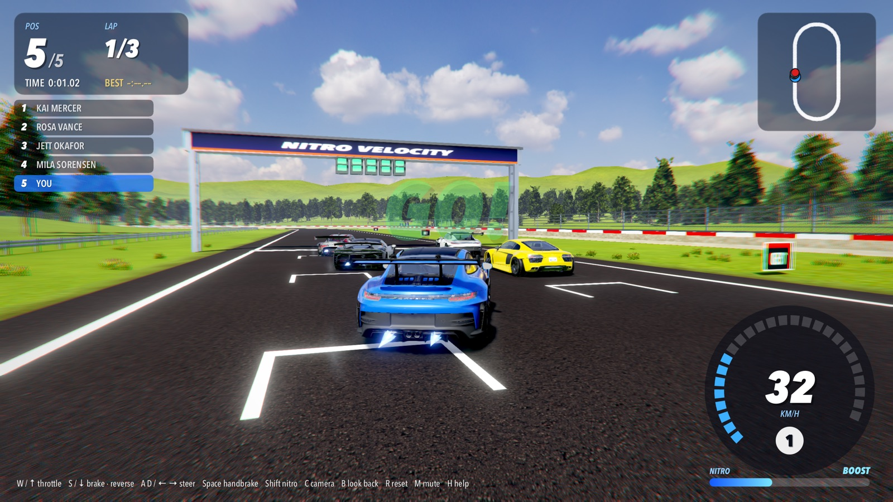

# nitro-velocity

[](https://github.com/vertex-language)
[](LICENSE)

A street-racing game. What's next is in
[`TODO.md`](TODO.md). Like vcraft and npc-sim, it is a thin program over packages.

**So far: the first map.** The Sunny Oval: 1.2 km of black asphalt
round two 110 m half circles, kerbs on the turns, a concrete wall
outside and steel barriers inside, green grass, trees and hills, a
grandstand full of people and a start gantry, under a summer sky. Choose
your car on the grid (a Porsche 911 GT3 RS, Nissan GT-R, Audi R8, Ferrari
SF90 XX Stradale or Toyota GR Supra GT300); four rivals get theirs at
random, and you race three laps from a standing start under the lights. Beat them to the flag; the
results come up on a frosted glass panel. Engines, tires, wind, nitro and
the crowd are all synthesized as you play.



---

## Run

First fetch the textures, sky, cars and trees (about 230 MB of originals,
cooked into `assets/`; see [`ASSETS.md`](ASSETS.md)):

```bash
python3 tools/fetch_assets.py           # once; the cars and trees need SKETCHFAB_TOKEN
vsc run nitro-velocity                   # race
vsc run nitro-velocity -- --demo 140     # drives itself; saves screenshots/play-1…4.png
vsc run nitro-velocity -- --mute         # without sound
vsc run nitro-velocity -- --scale 0.75   # draw at 3/4 of the window's pixels
vsc run nitro-velocity -- --no-post      # without bloom, the grade, AO and FXAA
vsc run nitro-velocity -- --no-ao        # without ambient occlusion
vsc run nitro-velocity -- --no-reflections  # your car reflecting the sky alone
RUN_TRACE=1 vsc run nitro-velocity       # where each frame's time goes, once a second
```

On the grid, ← → (or A D) choose your car, Enter races. Then W or ↑ throttle, S or ↓ brake (and reverse when stopped), A D or ← →
steer, Space handbrake, Shift nitro, C change camera (chase, far chase,
bumper), B look back, R put the car back on the track, M mute, H hide the
keys, Enter back to choosing a car after the flag, Esc quit.

You start at the back of five. Nitro fills slowly by itself, faster
sliding sideways at speed and tucked in behind another car; it burns
while Shift is held. The rivals use theirs on the straights.

---

## What it's made of

| | Reused | nitro-velocity's own |
| :--- | :--- | :--- |
| The car | `physics/vehicle` (new): raycast suspension, tires on a friction circle, engine and automatic gearbox, brakes, handbrake, aero, a stability assist; `Collide` between cars, `Push` against walls | `race.LoadCars`, `race.Build`: each car's build from its model's measurements (`data/cars.json`) |
| Its look | `scene/gltf` (reads clearcoat, emission, transmission, a second UV set, texture tiling now), `render/forward` (metallic and roughness, clearcoat, sky reflections, ambient occlusion, emission, blended glass now) | `look/car.vs`: each model batched by material, its wheels apart to steer and roll, six paints, three levels of detail; `look/hud.vs`: choosing a car |
| The sky and its light | `image/hdr` (new), `forward.Environment` (new): the HDR sky as the backdrop, its sun found and casting the shadows, reflections at every roughness, its diffuse light; cooked once | the sky's yaw (the sun behind your left shoulder down the straight) |
| The track | `mesh`, `math/noise` | `track`: the oval from data, where a point is along and across it, surfaces, walls, the grid; its meshes; `data/sunny-oval.json` |
| Round the track | `scene/scatter`, `scene/gltf` | `look/scenery.vs`: the grandstand, gantry and lights, boards, hills; where the trees (fir, pine, noble fir) and grass clumps stand, from Sketchfab (`assets/foliage`) |
| The race | `entity`, `entity/schedule`, `entity/run` | `race`: the countdown, laps, positions, lap times, nitro, drafting, walls and knocks, rescues; `race/driver.vs`: the rivals |
| The camera | `render/chase` (new): behind and above, on a spring, swinging round slides, wider with speed | the bumper camera |
| Sound | `media/mix` (new), `media/device` (new) | `sound`: a V8 per car, tires, wind, nitro, crowd, knocks, beeps, fanfare |
| The HUD | `image/draw`, `text/font` | `look/hud.vs`: speedometer, place, laps, times, map, countdown, results on frosted glass |

### Packages here

| Package | What it is |
| :--- | :--- |
| `nitro-velocity/track` | `Track`: a circuit from JSON (an oval of straights and half circles, or a smooth loop through points), its centerline sampled every meter with distance, tangent, left and curvature; `Locate` (along and across, quick from a hint), `At`, `Turn`, `Yaw`, `SurfaceAt` (asphalt, kerb, grass), `Ground()` (a vehicle's ground: kerbs ridged, grass slow), `Wall`, `Grid`. `Build`: the asphalt, lines, kerbs, finish line, grid boxes, wall and its band, barrier rails and posts, grass, in chunks along the lap. |
| `nitro-velocity/race` | `Race`: the racers as entities, the schedule (input → drivers → cars → contacts → rules at 60 Hz), the lights, laps counted at the line both ways, the order, lap times, results, nitro and drafting, wall and car contacts, putting back cars stuck, flipped or lost. `Driver`: a racing line, speed planned from the turns ahead, pure pursuit with the turn's own steering fed forward, room given to cars alongside, overtaking, lifting when sliding, backing out of walls, nitro on straights. `CarInfo`, `LoadCars`, `Build`: the cars and their builds; `Picks`: the rivals' cars, dealt at random. |
| `nitro-velocity/look` | `Look`: the sky, the track and scenery, the trees, the cars on soft contact shadows, nitro flames, the start lights. `CarModel`, `Paints`. `HUD`. Textures painted by code. |
| `nitro-velocity/sound` | `Sound`: every voice set from the race as heard from the camera, written ahead to the device each frame. |

Textures, the sky and the cars are downloaded by `tools/fetch_assets.py`, each
checked against its SHA-256 (all free and open; the cars from Sketchfab, which
wants an account); see [`ASSETS.md`](ASSETS.md).

---

## Programs

```bash
vsc run nitro-velocity                 # the game
vsc run check                          # headless: the oval's length and turns, points found along and across, surfaces,
                                       # the walls, the grid; a race with everyone driving themselves (lights, green,
                                       # everyone finishing three laps on the road, no one put back, lap times, the order);
                                       # a car nose-first in the wall backs out; sound clean, engines louder and higher
                                       # flat out  [-- --wav out.wav]
vsc run snapshot -- [w] [h]            # draws your car, the grid, the field in a turn, the chase camera, the HUD, nitro,
                                       # into screenshots/, and times the frame with parts left out  [--bench n] [--parts]
vsc run probe -- [name] [from] [to]    # traces one car round the lap (for tuning the drivers)
```

On an M-series Mac: loading takes about 11 s, 7 of them the five cars'
models and textures (20 s more the first time, cooking the sky); a race
steps in 0.5 ms a frame; at the window's own pixels (2560 × 1440 on a
Retina display) the demo runs at 34–40 fps with the five cars (190–450k
triangles each, no lower levels of detail yet) and the Sketchfab trees
and grass; it ran at 60 with the old concept car and code-grown trees: frames are drawn on the GPU and presented
there (`gpu.Layer`, through `run.Window(…, present:)`), the HUD drawn on
the host as an overlay and sent up a region at a time, nothing read back.

---

## License

[MIT](LICENSE)
